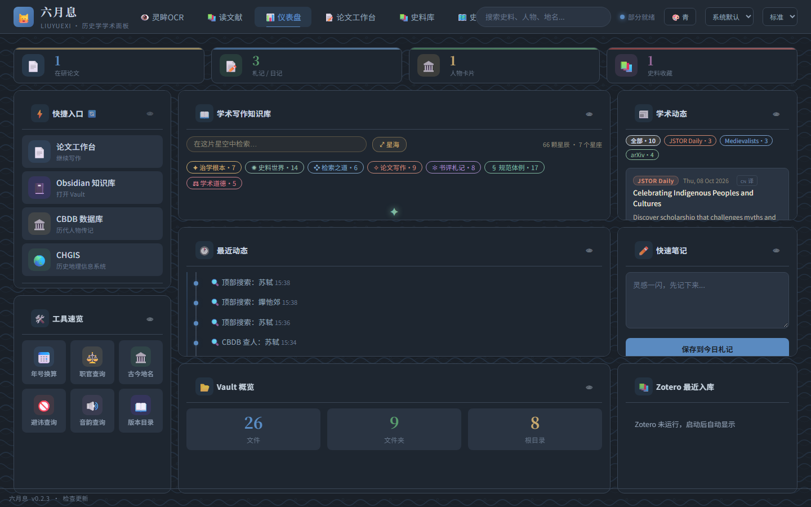
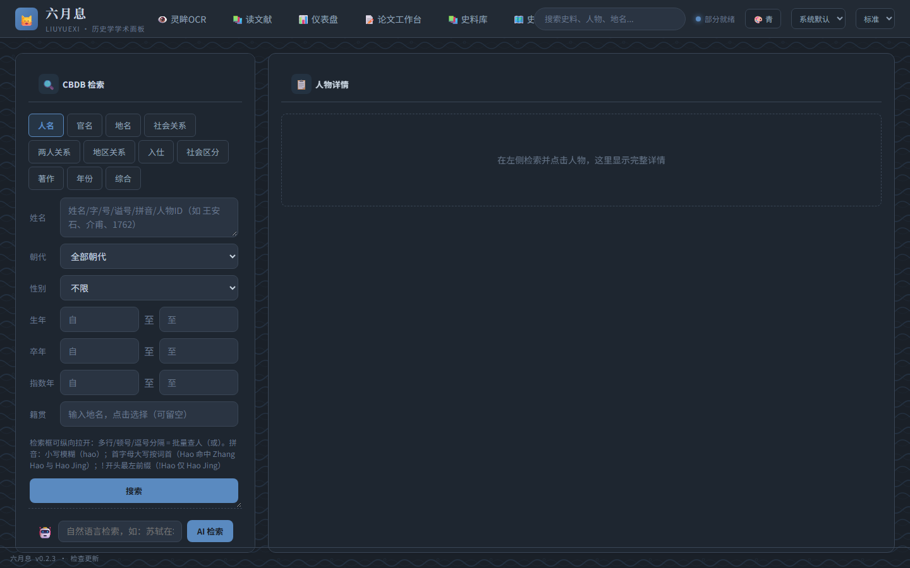
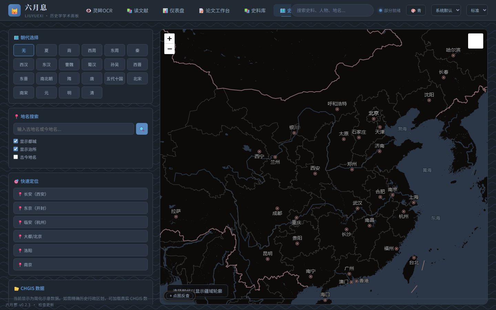

# 六月息 JuneXi

> 历史研究个人工作台——**史料的枢纽，不是 another Obsidian**
> 连接 CBDB 人物库、CHGIS 历史地图、Zotero 文献、Obsidian 笔记，
> 用插件系统把检索、分析、可视化做成一个可扩展的学术面板

## 为什么叫"枢纽"

Obsidian 和 Zotero 各管各的，CBDB 和地图数据更是各自为政。
六月息不做全功能的笔记软件或文献管理器——它做**连接者**：
让 CBDB 搜到的人物一键上地图，让 Zotero 读的文献一键存笔记，
让 AI 检索自动调用你本地的数据库，让插件开发者不用懂整个系统就能加功能。

## 界面预览

| 仪表盘（首页/工作台） | CBDB 检索（人名/职官/地名/社会关系 等九大模块） |
|---|---|
|  |  |

| 历史地图（高德中文暗夜底图 + CHGIS 朝代图层） | 插件系统（Zotero 联动/灵眸 OCR/百度 OCR） |
|---|---|
|  |  |

## 核心功能

| 模块 | 说明 |
|---|---|
| 🏛️ CBDB 检索 | 中国历代人物传记资料库（613MB 本地 Access 库），支持人名/职官/地名/入仕/社会区分/著作/亲属递归/社会关系/两人路径九大检索；五服制度自动标注；GeoJSON 导出上地图 |
| 🗺️ 历史地图 | CHGIS 底图 + 高德中文标注；朝代图层联动；群体人物上地图（籍贯/任职地/生卒地）；人生轨迹视图（苏轼贬谪路线一眼可见） |
| 📖 读文献 | Zotero 全库列表（73+ 条目） + 内嵌 PDF 阅读器 + 边读边记直写 Obsidian 文献笔记（带 zotero:// 回链） |
| 📚 史料库 | 70 个精选数据库导航（校内资源/综合古籍/期刊论文/简牍敦煌/数字人文工具等），支持多库联合检索和 AI 导购 |
| 🛠️ 史学工具 | 年号换算/避讳查询/音韵反切/职官查询/古今地名/版本目录，附工具书依据和核查路径 |
| 🤖 AI 助手 | 多供应商模型（DeepSeek 官方 ×2 + 硅基流动 ×8 + OpenClaw 网关）；内置提示词库 17 条（分读史料/写作/自检/语言四类，可折叠可搜索）；「自动操作」模式（试验）：AI 经 function calling 直接查 CBDB/打开详情/上图，动作白名单只读 |
| 🧩 插件系统 | 文件夹即插件（manifest.json + routes.py），支持页面注入/一键启用停用/市场安装（URL/本地 .jxplugin）/registry 注册（PR 上架） |
| 📰 学术动态 | arXiv 数字人文/计算历史学 + Medievalists.net + JSTOR Daily RSS 聚合，支持自定义源和 AI 中文翻译 |
| ⌨️ 快捷键 | Ctrl+0=仪表盘, Ctrl+1~8=主标签, Ctrl+9=插件, Ctrl+/=全局搜索, Ctrl+B=打开 Obsidian, F11=专注模式 |

## 快速开始

```bash
pip install -r requirements.txt   # Flask + pywebview + requests + sxtwl 等
python app.py                     # 默认 127.0.0.1:5000
```

打包（Windows）：`python -m PyInstaller -y JuneXi.spec` → `dist/JuneXi/`

## 数据依赖（不在仓库内）

- **CBDB**：从 [CBDB 官网](https://projects.iq.harvard.edu/cbdb/) 下载 Access 版，放至 `Documents/historia-data/cbdb/`（可用环境变量 `CBDB_DATA_PATH` 覆盖）
- **CHGIS**：同目录 `chgis_data/`（V6 版）
- **Zotero**：需本地客户端运行（默认端口 23119）
- **Obsidian**：需 Local REST API 插件（端口 27123），或直接用文件系统模式
- **DeepSeek API**（可选）：`.env` 里 `DEEPSEEK_API_KEY=`，缺省时回退 OpenClaw 网关

## 插件

| 插件 | 功能 |
|---|---|
| 📖 Zotero 联动 | 本地客户端状态/检索/书库/最近阅读 + PDF 内嵌直读 + 笔记落盘 Obsidian |
| 🕹 AI 自动操作 | AI 助手 function calling 工具循环，直接操作 JuneXi（查 CBDB/开详情/上图）；开关在 AI 助手页，禁用时退回纯对话 |
| 👁️ 灵眸 OCR | 本地古籍 OCR（PP-OCRv6），拍照→识别→句读→实体标注→错字校对→存 Obsidian 全链路 |
| 🔍 百度 OCR | 云端高精度备选（`plugins/baidu-ocr`，需 API key） |
| 🕸 文献图谱 | 顺藤摸瓜：粘贴知网/国社科导出的题录（Refworks/GB7714），生成引用关系网（参考文献+引证文献双向），侧栏题录+原文检索跳转；不直连知网，走官方导出合规解析 |

### 开发插件

写一个 `manifest.json` + `routes.py` 放进 `plugins/` 文件夹即可。支持：
- `nav` 字段注入顶部导航
- `assets` 字段自动注入 CSS/JS
- `capabilities: ["ocr"]` 声明为 OCR provider（按 priority 自动降级）
- 市场安装：URL 或本地 `.jxplugin` 文件一键安装

详见 [docs/插件开发指南](docs/插件开发指南.md)。

## 安全说明

**未签名验证**——首次运行 Windows SmartScreen / 360 等可能弹"未知发布者"警告，属正常现象。

- 本仓库全源码可审计，不做任何隐蔽联网行为
- 安全软件报警属误报，PyInstaller 打包的开源程序常被误标
- 可将 JuneXi.exe 上传 [VirusTotal](https://www.virustotal.com) 自查

## 插件路由（plugins/）

插件经 `plugin_loader.py` 挂载，路由前缀 `/api/` 或 `/plugin/`：

- **litgraph 文献图谱**：`/api/litgraph/import`（知网/国社科文本建图）· `/api/litgraph/oa_search`（OpenAlex 标题/DOI 候选）· `/api/litgraph/oa_expand`（种子建图：参考+被引+相关，related 为虚线第四色）· `/api/litgraph/oa_expand_node`（R111 节点级联扩展：任意带 oa_id 的节点再扩一层并入当前图，kind=ext）· `/api/litgraph/list` / `graph/<gid>` / `delete/<gid>`
- **ai-agent**：`/api/ai/agent`（Agent 模式多步执行：LLM 决策动作→服务端校验执行→逐步返回）；前端开关在 🤖 AI 助手页左栏「🕹 Agent 模式」卡片
- **feed / zotero / cbdb**：见各插件 manifest.json 与源码

## 插件参数配置（R115）

Obsidian 式声明设置：插件在 `manifest.json` 的 `settings.fields` 声明字段（`bool`/`int`/`select`/`text`/`password`，含 `default`/`min`/`max`/`options`），插件管理页卡片上的 ⚙ 按钮展开设置面板，改即存。

- 端点：`GET /api/plugins/<pid>/config`（声明+当前值）· `PUT /api/plugins/<pid>/config`（`{updates:{k:v}}`，按声明校验：int 裁剪 min/max、select 校验 options、未声明字段 400）
- 存储：`%LOCALAPPDATA%\JuneXi\plugin-config.json`（原子写，与 plugin-overrides.json 并列）；插件运行时经 `plugin_loader.get_plugin_config(pid)` 读合并值（manifest 默认 + 用户覆盖）
- 列表 API 每项带 `has_settings`；`plugin_loader.validate_plugin_config` 做写入校验
- 试点：litgraph（n_refs/n_citedby/n_related 默认扩展量）、ai-agent（max_steps/max_tool_calls）；显式请求参数优先于配置默认
- 测试：`_test_plugin_cfg.py`（16 项，monkeypatch 用户目录隔离）

## 测试

```bash
python _test_phase1.py      # CBDB 检索回归（14 项）
python _test_phase2.py      # 亲属递归+五服
python _test_phase3.py      # 三期跨查询传递
python _test_phase4.py      # 社会关系检索
python _test_phase5.py      # 二期关系递归
python _test_phase6.py      # 六期群体网络
python _test_phase7.py      # 两人亲属路径 BFS（19 项）
python _test_phase8.py      # 地图联动
python _test_phase10.py     # 地图联动深化（16 项）
python _test_agent.py       # Agent 模式（44 项）
python _test_litgraph.py    # 文献图谱（40 项）
python _test_plugin_cfg.py  # 插件参数配置（24 项）
python _test_toolbook_t2s.py  # 工具书简繁折叠守护（10 项，需 venv 装 opencc-python-reimplemented）
# 共 13 个测试文件 230+ 项
```

## 技术栈

Flask · pywebview（WebView2）· PyInstaller · Leaflet + 高德瓦片 · ECharts 力导向图 · sxtwl · Access via pyodbc/win32com

## 作者与致谢

作者：Korm · 开发协作：Auto-Korm（AI 结对编程）

致谢：CBDB（哈佛燕京学社等）· CHGIS（哈佛燕京社）· 中国哲学书电子化计划 · Kanripo 汉籍 Repository · 荣新江《学术训练与学术规范》

## License

[MIT](LICENSE)

---

*"去以六月息者也"——《庄子·逍遥游》*
